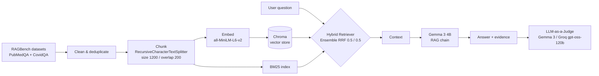

# Clinical Decision Support: Medical RAG

A Retrieval-Augmented Generation (RAG) system that answers biomedical and COVID-19 research
questions **only from retrieved medical literature**, shows the supporting evidence alongside
every answer, and evaluates answer quality with an **LLM-as-a-Judge**. The project ships with a
professional Gradio user interface.

> **Research support only.** This assistant summarises published abstracts. It does not diagnose,
> prescribe, or replace clinical judgement.

---

## Table of Contents

- [Features](#features)
- [Architecture](#architecture)
- [Datasets](#datasets)
- [Pipeline](#pipeline)
- [Evaluation](#evaluation)
- [User Interface](#user-interface)
- [Getting Started](#getting-started)
- [Configuration & Secrets](#configuration--secrets)
- [Project Structure](#project-structure)
- [Results](#results)
- [Limitations](#limitations)
- [Acknowledgements](#acknowledgements)

---

## Features

- **Hybrid retrieval** combining sparse (BM25) and dense (Chroma vector) search via Reciprocal
  Rank Fusion for more robust evidence recall.
- **Grounded generation** with Google **Gemma 3 4B** — answers are constrained to the retrieved
  context.
- **Dual LLM-as-a-Judge evaluation**: a same-model judge (Gemma 3) and a different-model judge
  (`openai/gpt-oss-120b` via Groq) for less biased scoring.
- **Batch evaluation** over the first 50 questions of PubMedQA and CovidQA, with score
  distribution charts.
- **Professional Gradio UI** with question triage, safety refusals, linked citations, highlighted
  evidence cards, session history/export, a feedback logger, and a live "score this answer" tab.

---

## Architecture



---

## Datasets

The project uses the [`galileo-ai/ragbench`](https://huggingface.co/datasets/galileo-ai/ragbench)
benchmark:

| Source     | Split used | Columns kept                      |
| ---------- | ---------- | --------------------------------- |
| `pubmedqa` | `train`    | `question`, `documents`, `response` |
| `covidqa`  | `train`    | `question`, `documents`, `response` |

Both subsets are concatenated into a single corpus. Cleaned CSV exports
(`pubmedqa_training.csv`, `covidqa_training.csv`) are produced during the run.

---

## Pipeline

1. **Load** PubMedQA and CovidQA and keep only `question`, `documents`, `response`.
2. **Clean** text (whitespace normalisation, bracket/formatting cleanup) and **deduplicate**
   document groups.
3. **Chunk** documents with `RecursiveCharacterTextSplitter` (`chunk_size=1200`,
   `chunk_overlap=200`).
4. **Embed** chunks with `sentence-transformers/all-MiniLM-L6-v2` (GPU if available) and index them
   in **Chroma**.
5. **Retrieve** with an `EnsembleRetriever` combining **BM25** (`k=5`) and **Chroma**
   (`k=5`) at equal weights.
6. **Generate** grounded answers with **Gemma 3 4B** (`google/gemma-3-4b-it`) through a LangChain
   RAG chain (retrieve → format → prompt → generate → parse).

---

## Evaluation

Answers are scored on a 1–5 scale by an LLM-as-a-Judge that compares the generated answer against
the dataset's ground-truth response:

- **Same-model judge** — Gemma 3 4B scores its own system's answers.
- **Different-model judge** — `openai/gpt-oss-120b` via the Groq API for reduced self-bias.

Batch evaluation runs over the first 50 questions of each dataset and renders a score-distribution
bar chart (via `matplotlib` / `seaborn`).

---

## User Interface

The UI is a self-contained Gradio app in [`rag_ui.py`](rag_ui.py). The notebook writes this file to
disk, then launches it by handing over the pipeline and judge functions via `launch_ui(...)`.

- **Answer tab** — generated answer with question-type / risk chips and the safety disclaimer.
- **Evidence tab** — retrieved hybrid-search chunks with query terms highlighted.
- **Score tab** — batch judge scores plus a **Score current answer** button that grades the
  on-screen answer live.
- Extras: safety refusals for diagnosis/prescription requests, linked PubMed citations, session
  history with Markdown export, and a feedback logger (`feedback.csv`).

---

## Getting Started

### Prerequisites

- Python 3.10+
- A GPU is recommended for Gemma 3 generation (CPU works but is slow).
- Accounts/tokens: a **Hugging Face** token (to download Gemma 3) and a **Groq** API key (for the
  different-model judge).

### Installation

```bash
pip install langchain-chroma langchain-retrievers-bm25 langchain-classic \
            langchain-groq langchain-huggingface
pip install -qU langchain langgraph langchain_core langchain_community chromadb \
            sentence-transformers langchain-openai biopython faiss-cpu transformers \
            accelerate pypdf rank_bm25 groq
pip install -q "pillow<13.0" gradio
```

### Run

1. Open `Clinical_Decision_Support_v8.ipynb` in Jupyter, Colab, or Kaggle.
2. Set your secrets (see below).
3. Run the cells top to bottom: setup → data prep → embeddings → retriever → model →
   generation → evaluation → UI.
4. The final cell prints a public `gradio.live` link for the UI.

---

## Configuration & Secrets

> **Never commit API keys or tokens to the repository.** If a key was ever committed, rotate it
> immediately.

Provide credentials through environment variables or your platform's secret manager (Colab
`userdata`, Kaggle Secrets) rather than hardcoding them:

```python
import os
from groq import Groq

HF_TOKEN = os.environ["HF_TOKEN"]            # Hugging Face token for Gemma 3
client = Groq(api_key=os.environ["GROQ_API_KEY"])  # Groq judge
```

Required secrets:

| Name           | Purpose                                      |
| -------------- | -------------------------------------------- |
| `HF_TOKEN`     | Download the gated `google/gemma-3-4b-it` model |
| `GROQ_API_KEY` | Different-model LLM-as-a-Judge via Groq      |

Add a `.gitignore` entry for any local secret files, CSV exports, and the Chroma store if you do not
intend to version them.

---

## Project Structure

```
.
├── Clinical_Decision_Support_v8.ipynb   # Main capstone notebook (pipeline + evaluation + UI launcher)
├── rag_ui.py                            # Gradio UI (written to disk by the notebook)
├── pubmedqa_training.csv                # Generated: cleaned PubMedQA export
├── covidqa_training.csv                 # Generated: cleaned CovidQA export
├── feedback.csv                         # Generated: UI feedback log
└── README.md
```

---

## Results

- Grounded answers restricted to retrieved medical evidence, with inline citations.
- Batch LLM-as-a-Judge scores (1–5) for PubMedQA and CovidQA, visualised as score-distribution
  charts and summarised as mean correctness per dataset and judge.

Exact scores depend on model versions, hardware, and sampling. Re-run the evaluation cells to
reproduce the charts for your environment.

---

## Limitations

- Research/education use only — **not** a diagnostic or prescriptive tool.
- Answer quality is bounded by the retrieved corpus and the Gemma 3 4B model.
- LLM-as-a-Judge scores are approximate and can be biased; treat them as a relative signal, not
  ground truth.
- Evaluation is limited to the first 50 questions of each dataset for runtime reasons.

---

## Acknowledgements

- [RAGBench](https://huggingface.co/datasets/galileo-ai/ragbench) (`galileo-ai`) for the datasets.
- [Google Gemma 3](https://huggingface.co/google/gemma-3-4b-it) for generation.
- [Groq](https://groq.com/) for fast inference of the `gpt-oss-120b` judge.
- [LangChain](https://www.langchain.com/), [Chroma](https://www.trychroma.com/),
  [Sentence-Transformers](https://www.sbert.net/), and [Gradio](https://www.gradio.app/).
